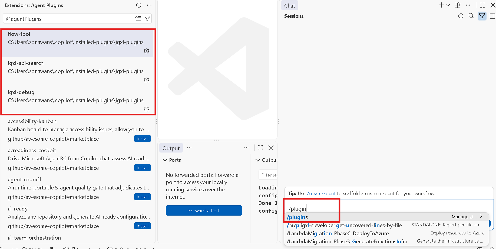
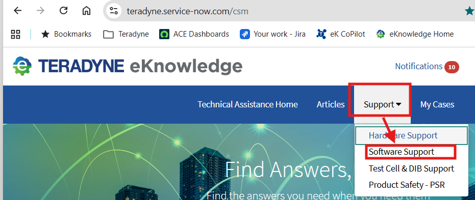
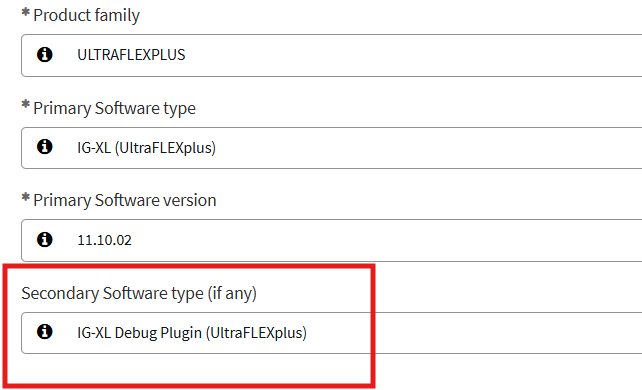

# IG-XL Debug

Use an AI coding assistant to look up IG-XL APIs, generate grounded C#, execute
debug actions at a breakpoint, and inspect live program state.

The suite contains three separately installed plugins:

| Plugin | Purpose |
| ------ | ------- |
| [igxl-api-reference](igxl-api-reference/README.md) | Public API lookup and evidence-first C# generation. |
| [igxl-api-execution](igxl-api-execution/README.md) | Execute C# debug actions against a stopped IG-XL test program. |
| [igxl-flow-manager](igxl-flow-manager/README.md) | Inspect program state, flow position, and test context. |

## Prerequisites

- IG-XL 11.10.03 installed.
- GitHub Copilot CLI or Claude Code installed and authenticated.

## Install

1. **Add the marketplace.** At your Copilot CLI or Claude Code prompt, run:

   ```text
   /plugin marketplace add Teradyne-Inc/ate-agentic-toolbox
   ```

2. **Download executables.** Open this repository's **Releases** page and
   download these separate assets:

   | Plugin release | Assets |
   | -------------- | ------ |
   | `igxl-api-reference` | `igxl-api-reference-mcp.exe` |
   | `igxl-api-execution` | `igxl-api-execution-mcp.exe` |
   | `igxl-flow-manager` | `igxl-flow-manager-mcp.exe`, `igxl-flow-manager-install.exe` |

   Place all three MCP server executables in one persistent folder on your user
   `PATH`, for example `C:\Users\<username>\.copilot\servers`. This is an example
   location, not a required Copilot or Claude directory. Restart your assistant
   after changing `PATH`. Do not use the automatic **Source code** archives as
   plugin packages.

   > **igxl-flow-manager users:** Complete the
   > [runtime installation and verification](igxl-flow-manager/README.md#runtime-setup)
   > before installing the plugin.

3. **Install plugins.** At your assistant's prompt, install each component separately:

   ```text
   /plugin install igxl-flow-manager@igxl-debug
   /plugin install igxl-api-execution@igxl-debug
   /plugin install igxl-api-reference@igxl-debug
   ```

The containing `igxl-debug` directory groups the documentation and components;
it is not an additional installable plugin.

## Verify and use

Confirm all three plugins are installed and enabled:

| Assistant | List plugins | List skills |
| --------- | ------------ | ----------- |
| GitHub Copilot CLI | `/plugin list` | `/skills list` |
| Claude Code | `/plugin list` | `/skills` |

For code execution, open an IG-XL test program and stop at a flow or C#
breakpoint before asking the assistant to execute a debug action.
See each component's README for usage details and included content.

In VS Code chat, `/plugins` shows installed plugins:



For registration and file-lock errors, see [Troubleshooting](docs/troubleshooting.md).

## Report issues or request features

For any IG-XL Debug plugin, submit issues and feature requests through the
[Teradyne eKnowledge portal](https://teradyne.service-now.com/csm):

1. Select **Support > Software Support** to open the Software Support form.

   

2. Fill in the form, selecting **Semiconductor Test** in the **Division**
   dropdown and **IG-XL Debug Plugin (UltraFLEXplus)** in
   **Secondary Software type (if any)**, then submit your request.

   
